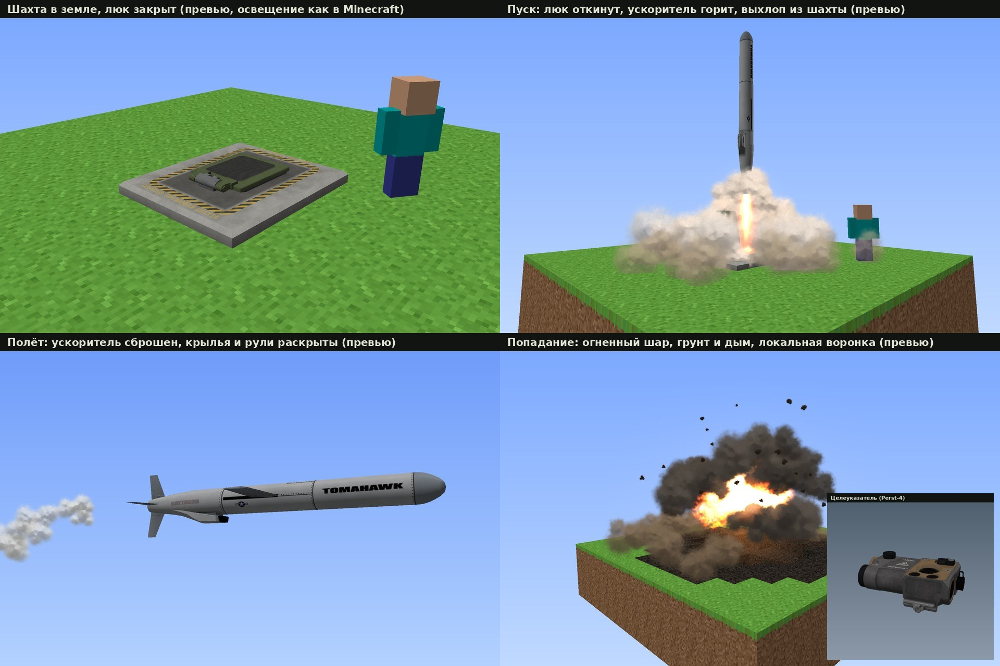

# Solo Silo: Conventional Rockets

**Minecraft Java 1.21.1 / Fabric / 0.4.0-rc1**

Пусковая шахта в земле в духе Solo Silo из Helldivers 2, только «как в реальности»: заглублённый контейнер с люком, лазерный целеуказатель и быстрая крылатая ракета с обычной боевой частью. Без космоса, без ядерки, без ванильных частиц, взрывов и звуков.



Это **полный исходный проект для GitHub Actions**, не готовый JAR. Версия **не собрана на настоящем Minecraft/Fabric classpath и не проверена в игре**. Что именно проверено, смотри `VALIDATION.md`.

## Что нового в 0.4.0

- **Модели художников вместо программных коробок** (CC BY 4.0, авторы в `THIRD_PARTY_NOTICES.md`):
  - ракета: BGM-109 Tomahawk, RickSlash. Реальный масштаб 6,25 блока, перекрашена в серый, запечённый AO;
  - шахта: ячейка VLS, DenisGLabrecque. Канистра 7 блоков в земле, наружу торчит только палуба, бетонный оголовок с жёлто-чёрной разметкой и надписями;
  - целеуказатель: Zenitco «Перст-4», ikoval31. Настоящая 3D-модель в руке (примерно 4x от реального размера).
- **Анимации**: люк откидывается на 100°, ускоритель горит внутри шахты, ракета выходит вертикально, отрабатывает разворот по крену, раскрываются рули, затем ускоритель отделяется и падает (реальным мешем), раскрываются крылья и воздухозаборник.
- **Новые VFX**: белый «цветной капустой» дым (новый атлас 8x8), выхлоп кипит из шахты, пылевое кольцо по земле, факел ускорителя и свечение сопла, плотный белый след на разгоне, тонкий на марше. Попадание: огненное ядро, тёмная оболочка дыма и грунта, бурая юбка пыли, летящие комья, искры, оранжевая вспышка, воронка из настоящих блоков.
- **Новые звуки** (синтез, свои): гидравлика люка, защёлка, рёв ускорителя с треском, пролёт, хлопок, взрыв с осыпью грунта.
- Текстуры с LOD (полная / 1/2 / 1/4 по дистанции) и линейной фильтрацией.

## Как играть

1. **Шахта**: ПКМ по верху твёрдого блока. Нужна площадка 3 x 3, открытое небо и копаемый столб 7 блоков вниз (без воды/лавы и сундуков). Шахта сама выкапывает этот столб; при сборе блоки возвращаются.
2. **Зарядка**: ПКМ ракетой по шахте.
3. **Пульт**: первый ПКМ пустой рукой выдаёт привязанный целеуказатель (или ПКМ своим целеуказателем, чтобы перепривязать).
4. **Пуск**: держи ПКМ с целеуказателем, наведи на точку 32–1024 блоков. Через полсекунды захват: люк открывается, через ~1,5 с ракета выходит.
5. **Наведение**: пока держишь ПКМ, ракета летит в точку луча. Отпустил: летит в последнюю принятую точку. 500 блоков примерно за 2,8 с, 1000 примерно за 3,9 с, высота не выше ~26 блоков.
6. **Забрать шахту**: присесть + удар (когда цикл пуска закончился).

Настройки сервера: `config/solo-silo.json` (пример в `config/solo-silo.example.json`): разрушение, радиусы, лимиты, плотность эффектов, тряска камеры.

## Сборка

1. Распакуй архив и залей **содержимое папки проекта в корень репозитория**, включая скрытую `.github`.
2. **Actions → build** (по push или Run workflow).
3. Скачай артефакт **solo-silo-jar**: `solo-silo-0.4.0-rc1.jar`.

Это замена проекта целиком, не патч. Старые миры с шахтой 0.3 лучше не использовать для первого теста.

Версии: Minecraft 1.21.1, Java 21, Fabric Loader 0.16.14+, Fabric API 0.116.4+1.21.1, Yarn 1.21.1+build.3, Gradle 8.14.3, Loom 1.11-SNAPSHOT.

```sh
python3 tools/validate_assets.py
gradle build --no-daemon --stacktrace
```

## Пересборка ассетов (не нужна для Gradle)

Готовые меши, текстуры и звуки уже лежат в `src/main/resources`. Чтобы пересобрать с нуля, скачай три glTF с Sketchfab в `tools/models/src/{tomahawk,vls,perst4}/` и запусти:

```sh
python3 tools/gen_models.py   # меши TMSH v2, текстуры с LOD, иконки (AO-запекание ~4 мин)
python3 tools/gen_fx.py       # атлас дыма (--all: и остальные FX)
python3 tools/gen_data.py     # модели предметов, рецепты, звуки, языки
```

Нужны Python 3 с NumPy, Pillow, SciPy и FFmpeg с libvorbis.

## Лицензии

Код и собственные ассеты: MIT (`LICENSE`). Производные от моделей Sketchfab: CC BY 4.0, указание авторства обязательно при распространении JAR (`THIRD_PARTY_NOTICES.md`). Неофициальный мод, не связан с Mojang/Microsoft или Arrowhead.
